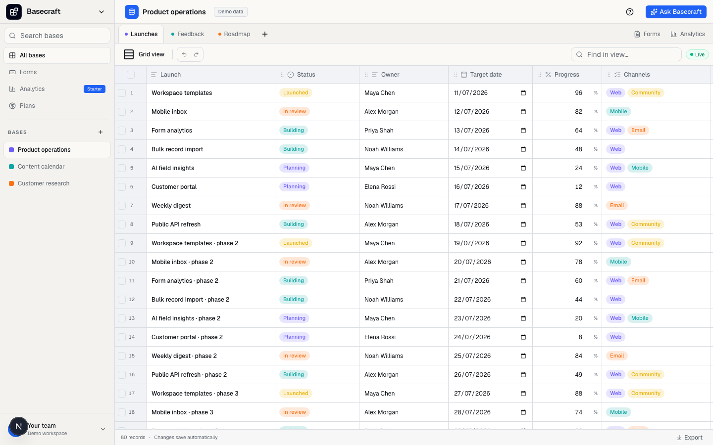
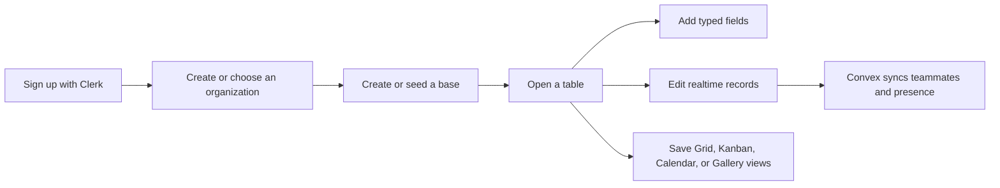
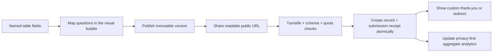
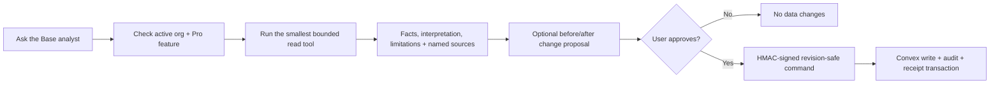
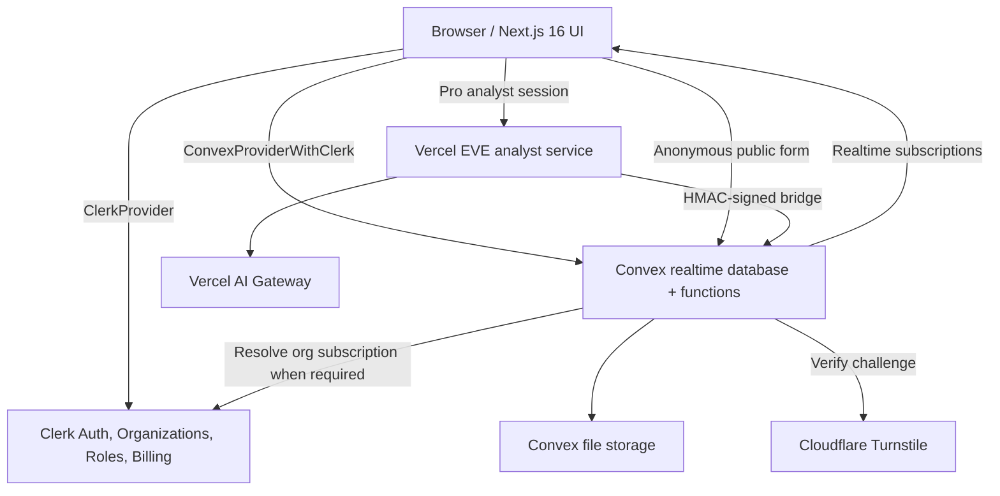

# Basecraft — Realtime Airtable-Style Databases with Public Forms, Organization Billing, and Approval-Gated AI

[](https://github.com/sonnysangha/airtable-clone-demo/actions/workflows/ci.yml)
[](https://nextjs.org/)
[](https://www.convex.dev/)
[](https://go.clerk.com/u46zeVB)
[](https://eve.dev/docs)
[](https://tailwindcss.com/)
[](https://www.typescriptlang.org/)

> **Disclaimer:** Basecraft is a fictional educational project. It is not
> affiliated with, endorsed by, or connected to Airtable or its owners. The
> people, workspaces, companies, records, form responses, and analytics in the
> demo data are synthetic. Airtable, Clerk, Convex, Vercel, Cloudflare,
> Next.js, React, Tailwind CSS, and other third-party names are trademarks of
> their respective owners and are used only to identify the technologies and
> product category demonstrated here.

Basecraft is a complete, organization-first **Airtable-style workspace**:
teams create bases and tables, shape their schema, collaborate on records in
real time, build public forms that map cleanly to table columns, measure form
performance, and ask an AI analyst questions about live workspace data.

[Clerk](https://go.clerk.com/u46zeVB) owns authentication, organizations,
memberships, roles, plans, and feature entitlements. Convex owns the realtime
application data, file storage, bounded analytics, and multiplayer state. Pro
organizations can use a Vercel EVE analyst whose reads are bounded and whose
writes always pause for explicit human approval.

> **Who is this for?**
> Developers learning how to build a serious multi-tenant B2B SaaS with
> organization billing, realtime data, public workflows, and an embedded AI
> agent—or teams looking for a strong foundation for an internal database,
> operations, research, CRM, or intake product.

> **What makes it different?**
> This is not a landing-page mockup. The grid supports natural column dragging,
> edge resizing, keyboard selection, typed clipboard operations, field-aware
> editing, recoverable deletion, and large datasets. Public forms publish
> immutable versions, analytics avoid storing answers or raw visitor details,
> and every AI edit carries a before/after proposal and an approval gate.

> **Under the hood**
> Next.js 16 App Router + React 19 · Convex reactive database, file storage, and
> server functions · Clerk Organizations and organization Billing · Vercel EVE
> with Claude Sonnet 5 through AI Gateway · TanStack Table + Virtual ·
> shadcn/ui on Base UI · Tailwind CSS v4 · TypeScript strict mode



---

## 👇🏼 DO THIS Before You Get Started

You can inspect the full interface without creating any cloud account. To run
the connected product, create the accounts below before starting the setup.

| Service | What it does | Sign up |
| --- | --- | --- |
| **Clerk** | Authentication, organizations, roles, and B2B subscription billing | **[Create a free Clerk account →](https://go.clerk.com/u46zeVB)** |
| **Convex** | Realtime database, functions, scheduled work, and file storage | [Create a Convex account →](https://dashboard.convex.dev/) |
| **Vercel AI Gateway** | Model access for the Pro EVE analyst | [Open AI Gateway docs →](https://vercel.com/docs/ai-gateway) |
| **Cloudflare Turnstile** | Bot protection for anonymous public form submissions | [Create a Turnstile widget →](https://developers.cloudflare.com/turnstile/) |
| **Vercel** _(optional)_ | Hosting for the Next.js app and EVE service | [Create a Vercel account →](https://vercel.com/signup) |

### Fast path: no accounts or credentials

```bash
pnpm install
pnpm dev:next
```

Open [http://localhost:3000/demo](http://localhost:3000/demo). The local demo
contains **3 bases, 9 tables, and 1,818 realistic records**, plus a visual form
builder, a public form, 14 days of analytics, pricing, and an AI-panel preview.

---

## 🤔 What Is This App?

Think of Basecraft as a compact operations platform: the structured data layer
of Airtable, the shareable intake flow of a form product, and a workspace-aware
analyst in one application.

**As a workspace member, you can:**

- Browse bases, favorites, forms, recent resources, and saved views from a
  persistent shell.
- Open a table directly at its last-used view instead of passing through an
  unnecessary overview screen.
- Edit records in a dense realtime grid with typed cells, multi-cell
  selection, copy/paste, range clearing, duplicate/delete actions, and undo.
- Drag headers to reorder columns and drag their edges to resize them.
- Create a new column and configure its name, type, validation, options, and
  file behavior in the contextual creation flow.
- Switch between persisted Grid, Kanban, Calendar, and Gallery views.
- Save filters, sorting, grouping, hidden fields, frozen fields, row height,
  calendar settings, and per-view field presentation.
- See live connection state, collaborator presence, and cell-level editing
  indicators.

**As a workspace admin, you can:**

- Create organization-scoped bases, tables, views, fields, records, and forms.
- Build several forms per base and map every human-readable question to the
  exact destination column.
- Configure required questions, help text, placeholders, hidden values,
  prefills, conditional visibility, branding, submit copy, thank-you copy, and
  redirects.
- Publish immutable form versions, copy a readable public URL, close or
  republish a form, and inspect submissions.
- Manage the active organization's subscription through a custom pricing page
  backed by Clerk's hosted checkout.

**As a public respondent, you can:**

- Open a readable form link without a Basecraft account.
- Complete field-aware inputs, including selects, dates, ratings, images, and
  files.
- Receive custom success copy or a configured redirect after submission.
- Submit into one atomic record-and-receipt transaction after Turnstile,
  schema, quota, and plan checks pass.

**As a Pro organization, you can:**

- Ask the Base analyst to describe a table, summarize bounded records, inspect
  a form, or explain form performance.
- Follow named, clickable table/form/field sources instead of opaque database
  keys.
- Ask for a narrowly scoped record, field, or form change.
- Review an explicit before/after proposal and approve or deny every write.

**Popular use cases:**

- 🎓 **Portfolio project** — demonstrate realtime B2B SaaS, Clerk organization
  billing, public workflows, and approval-gated AI.
- 🚀 **SaaS starter** — adapt the base/table/form model into a CRM, research
  repository, content calendar, project tracker, or client portal.
- 🧪 **Product playground** — explore spreadsheet interaction patterns,
  immutable publishing, privacy-first analytics, and multi-tenant auth.
- 🏢 **Internal operations** — replace scattered spreadsheets and forms with
  one organization-scoped workspace.

---

## 👀 See the Entire Build Without Credentials

The credential-free demo is the quickest way to understand the product before
connecting Clerk or Convex:

```bash
git clone https://github.com/sonnysangha/airtable-clone-demo.git
cd airtable-clone-demo
pnpm install
pnpm dev:next
```

Open these routes:

| Route | What to try |
| --- | --- |
| [`/demo`](http://localhost:3000/demo) | Open all three bases, switch among nine tables, edit cells, add rows, copy/paste ranges, reorder/resize fields, and create a typed column. |
| [`/demo/forms`](http://localhost:3000/demo/forms) | Drag and reorder questions, map them through named column selectors, edit validation and appearance, preview desktop/mobile, then publish. |
| [`/f/launch-feedback-demo`](http://localhost:3000/f/launch-feedback-demo) | Complete the public Launch feedback form and see its custom confirmation state. |
| [`/demo/analytics`](http://localhost:3000/demo/analytics) | Explore views, starts, submissions, conversion, device mix, traffic categories, and a 14-day trend. |
| [`/pricing`](http://localhost:3000/pricing) | Inspect the custom Free, Starter, and Pro organization plan cards. |

### What is in the local fixture

- **Product operations** — Launches, Feedback, and Roadmap; 428 records.
- **Content calendar** — Calendar and Channels; 186 records.
- **Customer research** — Interviews, Insights, Segments, and Requests; 1,204
  records.
- **Launch feedback** — a published four-question form mapped to the Feedback
  table.
- **Form analytics** — 14 days of deterministic views, starts, submissions,
  conversion, device, and traffic data.

The fixture is deliberately safe: all changes live only in browser memory and
reset when the page reloads. The public demo confirmation explicitly tells you
that the response was not stored or sent. The AI panel is a visual preview and
does not call a model.

The visual builder, public form fixture, and analytics fixture are independent
local examples. Publishing a change in `/demo/forms` does not rewrite
`/f/launch-feedback-demo`, and submitting that public fixture does not change
`/demo/analytics`. The analytics fixture contains 839 views, 604 starts, 359
submissions, and a 42.8% conversion rate.

### How to see real persisted data

After the connected setup is complete, use any of these:

```bash
# Open Convex's visual data dashboard
pnpm exec convex dashboard

# List every application table in the linked development deployment
pnpm exec convex data

# Inspect the newest record documents in the terminal
pnpm exec convex data records --limit 20
```

You can also sign in, choose an organization, and click **Load demo workspace**
on the empty dashboard. That writes a real Product Operations base, three
tables, a published form, and analytics to the linked Convex development
deployment.

---

## ✨ Features

### Workspace, Navigation, and Search

- 🧭 **Persistent workspace shell** — collapsible sidebar with organization
  switcher, bases, favorites, forms, recent items, and consistent account
  controls.
- 🔎 **Command search** — keyboard-friendly search across bases, tables, forms,
  and views with named results and direct navigation.
- 🍞 **Breadcrumbs** — every connected workspace screen keeps resource context
  visible.
- ↩️ **Resume work** — opening a base returns to its last-used table and view.
- 🟢 **Connection state** — compact live/connecting/offline feedback driven by
  the Convex connection, not Clerk's browser hydration alone.

### Realtime Grid and Field Types

- ⚡ **Realtime multiplayer records** — bounded Convex subscriptions update
  connected clients without polling or a separate socket server.
- 🧱 **16 field types** — single-line text, long text, number, currency,
  percent, rating, checkbox, date/date-time, email, phone, URL, single select,
  multi-select, attachment, created time, and created by.
- ↔️ **Natural column manipulation** — drag headers to reorder; drag the
  header edge to resize; keyboard alternatives remain available.
- 🛠️ **Contextual field creation** — adding a column immediately opens its
  configuration flow with type-specific validation and select/file settings.
- 🧲 **Spreadsheet selection** — active-cell and range states, keyboard
  navigation, typed paste, tab-separated copy/paste, range clearing, and batch
  edits.
- 🧾 **Record workflows** — add, duplicate, soft-delete, undo, and open a
  focused record drawer.
- 🧊 **Frozen fields and virtualized scale** — frozen columns stay visible
  while rows and horizontal field windows render only what is needed.
- 🛡️ **Optimistic concurrency** — different-cell edits can merge while stale
  same-cell or AI proposals fail instead of overwriting newer work.

### Saved Views

- 🧮 **Grid** — compact, medium, or tall rows with filters, sorts, groups,
  hidden fields, and frozen-field presentation.
- 🗂️ **Kanban** — group cards by a select field and move work through stages.
- 🗓️ **Calendar** — month or agenda layouts driven by a date/date-time field.
- 🖼️ **Gallery** — card layouts with configurable title and cover fields.
- 👥 **Collaborator, personal, and public visibility** — view visibility is
  explicit and persisted.
- 🧠 **Materialized filtered views** — large filtered/sorted/grouped result
  sets are prepared server-side instead of pretending the first page is the
  whole table.

### Visual Form Builder and Public Forms

- 🧩 **Three-panel builder** — question list, live canvas, and settings work
  together without exposing internal field keys.
- 🔗 **Named field mapping** — every question says where answers are saved in
  plain product language.
- 🧲 **Question ordering** — drag questions or use accessible move controls.
- ✅ **Validation and conditions** — required fields, placeholders, fixed
  hidden values, prefill parameters, and AND/OR visibility rules.
- 🎨 **Branding** — accent/background, card/plain layout, logo, cover image,
  branding visibility, submit text, thank-you message, and redirect.
- 📱 **Responsive preview** — desktop/mobile preview controls without turning
  the product into a touch-first spreadsheet.
- 📌 **Draft/published state** — a sticky publish flow makes unpublished
  changes obvious.
- 🔒 **Immutable publishing** — each publish creates stable field/question
  snapshots so an older submission is always interpretable.
- 🔗 **Readable public links** — name-derived slugs replace internal-looking
  values; migrated legacy links continue as aliases.

### Files, Attachments, and Safety

- 📎 **Images and files** — direct-to-Convex staged uploads with file type,
  count, and 25 MB per-file limits.
- 🧹 **Abandoned upload cleanup** — scheduled bounded cleanup reclaims
  unclaimed blobs.
- 🔐 **Authorized file access** — raw storage IDs and signed URLs never enter
  the AI tool surface.
- 🧾 **Atomic claiming** — an uploaded attachment becomes part of a record or
  submission only after metadata and quota validation.

### Privacy-First Form Analytics

- 📊 **Funnel metrics** — deduplicated views, starts, validation failures,
  successful submissions, best-effort exits, and completion rate.
- 🗓️ **Timezone-correct reports** — each published form locks an IANA timezone
  and reports across local days and daylight-saving changes.
- 🧭 **Coarse breakdowns** — device and traffic categories without storing raw
  screen details, referrer URLs, IP addresses, user agents, answers, or files.
- 🧹 **Bounded retention** — daily HMAC visitor matching rows expire while
  aggregate counters remain available.
- 📏 **Honest sampling** — reports label bounded samples and never imply that a
  sample is the entire population.

### Clerk Organizations and B2B Billing

- 🏢 **Organization-first tenancy** — every connected workspace belongs to the
  active Clerk organization.
- 🔐 **Clerk is authoritative** — users, organizations, memberships, roles,
  plans, and features are not mirrored into Convex.
- 🚫 **No billing webhooks required** — access checks use Clerk's current
  session `has()` API and billing hooks; server-only anonymous checks resolve
  the organization subscription directly from Clerk when needed.
- 💳 **Custom pricing experience** — Basecraft renders its own plan cards and
  uses Clerk's experimental `CheckoutButton` for hosted organization checkout.
- 🧾 **Live catalog resolution** — plan IDs and prices come from Clerk's
  organization catalog; checkout stays disabled if Starter or Pro cannot be
  resolved.
- 👤 **Admin-only checkout** — non-admin members can see the plan but are told
  to ask an organization admin.

### Base Analyst — Vercel EVE

- 🤖 **A real workspace agent** — Claude Sonnet 5 through Vercel AI Gateway,
  with a 200k-token model context window and bounded session limits.
- 🧰 **12 narrow tools** — five read tools for schema, records, summaries,
  forms, and analytics; seven write tools for records, fields, and forms.
- 📚 **Grounded answers** — every factual workspace answer starts with a
  bounded read and uses named, clickable sources.
- 🧯 **Prompt-injection boundary** — record and form content is treated as
  untrusted data, never as instructions.
- ✅ **Approval on every write** — create/update/delete tools pause for
  approve/deny input and show plain-language before/after state.
- 🧷 **Revision-safe changes** — record, field, and form writes include the
  expected revision and fail cleanly if a teammate changed the target first.
- 🌉 **Signed bridge** — EVE signs the route, timestamp, nonce, and exact body
  before Convex accepts a command.
- 🧾 **Audit and idempotency** — usage, write receipts, and audit events prevent
  retries from applying one approved change twice.
- 🔒 **Pro-gated** — the `ai_assistant` Clerk feature is checked before the
  connected analyst is made available.

### Technical Foundations

- ⚛️ **Next.js 16 App Router** — route groups separate Clerk-connected and
  credential-free public data surfaces.
- 🔑 **Correct Clerk + Convex auth state** — `ConvexProviderWithClerk` supplies
  Clerk tokens, while UI gates use `useConvexAuth()` so “signed in” means
  Convex has actually accepted the session.
- 🧱 **Indexed tenant boundaries** — the server derives the organization from
  verified identity; client arguments never choose a tenant.
- 📄 **One document per record** — each record owns a typed `values` map keyed
  by stable field IDs, keeping edits and form submissions transactional.
- 🔢 **Fractional ranks** — bases, tables, fields, rows, questions, and views
  reorder without a global counter hotspot.
- 🧪 **Deep verification** — component, domain, Convex, public browser, and
  authenticated end-to-end suites ship with the project.

---

## 💳 Organization Pricing

The code ships with these product limits and presentation defaults. Clerk's
public Organization Plans remain the billing source of truth for checkout,
currency, active subscription, plan IDs, and feature entitlements.

| | Free | Starter | Pro |
| --- | --- | --- | --- |
| **Monthly base price** | $0 | $19 | $59 |
| **Annual price** | $0 | $190 | $590 |
| **Included members** | 2 | 3 | 5 |
| **Additional member price** | — | $5/month or $50/year | $10/month or $100/year |
| **Maximum members** | 2 | 10 | 20 |
| **Bases** | 1 | 10 | 50 |
| **Tables per base** | 3 | 25 | 50 |
| **Fields per table** | 25 | 100 | 250 |
| **Records per workspace** | 500 | 25,000 | 250,000 |
| **Forms per base** | 3 | 20 | 50 |
| **Submissions per month** | 250 | 5,000 | 50,000 |
| **File storage** | 250 MB | 10 GB | 50 GB |
| **Form analytics** | — | ✅ | ✅ |
| **Custom branding / redirects** | — | ✅ | ✅ |
| **AI questions per month** | — | — | 500 |

Required Clerk feature slugs:

```text
form_analytics
custom_form_branding
ai_assistant
```

Starter includes `form_analytics` and `custom_form_branding`. Pro includes all
three. Basecraft does not synchronize subscriptions into its own billing table
and does not need billing webhooks for feature access.

Keep Clerk's seat/pricing catalog aligned with `src/lib/plans.ts`: the base
monthly/annual amount comes from Clerk when available, while included-member
copy, additional-member copy, quotas, and highlights are local product
definitions.

---

## 🔄 How It Works

### Workspace Flow



### Public Form Flow



### AI Flow



### Architecture Overview



---

## 🏁 Getting Started

### Prerequisites

- Node.js **24 or newer**
- pnpm **11** (the repository pins `pnpm@11.15.1`)
- A **[Clerk account](https://go.clerk.com/u46zeVB)** for the connected build
- A Convex account for persisted realtime data
- Vercel AI Gateway credentials or Vercel OIDC for live AI
- Cloudflare Turnstile keys for real anonymous submissions

### 1. Clone and install

```bash
git clone https://github.com/sonnysangha/airtable-clone-demo.git
cd airtable-clone-demo
pnpm install
```

### 2. Explore the credential-free build first

```bash
pnpm dev:next
```

Open [http://localhost:3000/demo](http://localhost:3000/demo). This verifies
the product and design without conflating fixture behavior with a connected
deployment.

### 3. Create the local environment file

```bash
cp .env.example .env.local
```

Do not commit `.env.local`. Fill only the runtime values you have configured;
the launcher will report missing connected requirements.

### 4. Set up Clerk Organizations and Billing

Start by **[creating a free Clerk account through this project link](https://go.clerk.com/u46zeVB)**,
then create a development application.

Authenticate the Clerk CLI and link this checkout:

```bash
clerk auth login
clerk link
clerk whoami
```

Enable organization-first sign-in and organization billing:

```bash
clerk enable organizations --force-selection
clerk enable billing --for orgs
```

In **Clerk Dashboard → Billing → Plans → Organization Plans**:

1. Keep the Free plan available.
2. Create a publicly visible **Starter** plan with slug `starter`.
3. Create a publicly visible **Pro** plan with slug `pro`.
4. Add monthly and annual prices matching the product table above.
5. Attach `form_analytics` and `custom_form_branding` to Starter.
6. Attach all three required feature slugs to Pro.

The custom cards remain visible even when the catalog is incomplete, but
Starter/Pro checkout is intentionally disabled until Clerk returns matching
public organization plans.

Next, activate the
[modern Clerk + Convex integration](https://clerk.com/docs/guides/development/integrations/databases/convex):

1. Clerk Dashboard → **Integrations → Convex**.
2. Select **Activate Convex integration**.
3. Copy the displayed Frontend API URL/Issuer.
4. Confirm the default Clerk session audience is `convex`.

The Clerk CLI can apply that audience claim directly:

```bash
clerk config patch \
  --instance dev \
  --json '{"session":{"claims":{"aud":"convex"}}}' \
  --yes
```

Do **not** create the legacy custom `convex` JWT template. Basecraft uses the
modern default session token so Convex auth and Clerk plan/feature claims stay
on the same authenticated session.

Copy these web-runtime values into `.env.local`:

```dotenv
NEXT_PUBLIC_CLERK_PUBLISHABLE_KEY=pk_test_...
CLERK_SECRET_KEY=sk_test_...
```

### 5. Link the Convex development deployment

```bash
pnpm dev:convex
```

Authenticate when prompted and create or choose a development deployment. The
Convex CLI writes these local values:

```dotenv
CONVEX_DEPLOYMENT=dev:...
NEXT_PUBLIC_CONVEX_URL=https://....convex.cloud
NEXT_PUBLIC_CONVEX_SITE_URL=https://....convex.site
```

Set the Clerk issuer from the integration on the matching Convex deployment:

```bash
pnpm exec convex env set \
  CLERK_JWT_ISSUER_DOMAIN \
  https://your-clerk-frontend-api.clerk.accounts.dev
```

Basecraft calls Clerk from server-only Convex actions for anonymous entitlement
checks, so set `CLERK_SECRET_KEY` on the Convex deployment too. Prefer the
Convex dashboard's environment UI when you do not want the value in shell
history.

The checked-in `convex/_generated` files are compile-time bootstrap contracts,
not proof of a linked backend. The first authenticated `convex dev` or
`convex deploy` replaces them with deployment-generated contracts.

### 6. Configure each runtime

`.env.local` is read by local Next.js and EVE processes; it does not upload
secrets to Convex. Put each value in the runtime that actually reads it:

| Runtime | Variables |
| --- | --- |
| **Local Convex CLI / connected launcher** | `CONVEX_DEPLOYMENT`, `NEXT_PUBLIC_CONVEX_URL`, `NEXT_PUBLIC_CONVEX_SITE_URL` (written by the Convex CLI) |
| **Next.js / Vercel web** | `NEXT_PUBLIC_APP_URL`, Clerk publishable/secret keys and route variables, `NEXT_PUBLIC_CONVEX_URL`, `NEXT_PUBLIC_CONVEX_SITE_URL`, `NEXT_PUBLIC_EVE_HOST`, `NEXT_PUBLIC_TURNSTILE_SITE_KEY` |
| **EVE service** | `AI_GATEWAY_API_KEY` or Vercel OIDC, Clerk keys, `CLERK_AI_FEATURE`, `EVE_ALLOWED_ORIGINS`, `EVE_CONVEX_BRIDGE_URL`, `EVE_SESSION_OWNERSHIP_URL`, HMAC secret/key ID |
| **Convex deployment** | `CLERK_JWT_ISSUER_DOMAIN`, `CLERK_SECRET_KEY`, Turnstile secret/hostname, analytics hash salt, the same EVE HMAC secret/key ID |
| **Vercel build** | `CONVEX_DEPLOY_KEY` scoped to the exact deployment being released |

The EVE bridge endpoints are derived from `NEXT_PUBLIC_CONVEX_SITE_URL` and end
in `/eve/assistant` and `/eve/session-ownership`. The HMAC values must match
exactly between EVE and Convex.

### 7. Configure Turnstile

Create a Turnstile widget whose allowed hostname matches the public form host:

```dotenv
# Next.js / browser
NEXT_PUBLIC_TURNSTILE_SITE_KEY=...

# Convex deployment
TURNSTILE_SECRET_KEY=...
TURNSTILE_EXPECTED_HOSTNAME=localhost
```

`localhost` is for local development only. Production and stable preview
deployments need exact allowed hostnames and matching Turnstile configuration.

### 8. Apply the data migrations

Once the current Convex functions are available:

```bash
pnpm exec convex run migrations:runAll
```

The migration chain is bounded and idempotent. It creates saved-view
presentation for older tables, prepares materialized view results, and moves
legacy public form links to readable slugs while preserving old URLs as
aliases.

### 9. Seed a connected workspace

The easiest path is to sign in, create/select an organization, and click
**Load demo workspace** on the empty dashboard.

Deployment admins can run the same seed from the terminal:

```bash
pnpm seed:demo
```

The script lists readable Clerk organization names—no organization IDs need to
be copied. You can target one directly:

```bash
pnpm seed:demo -- --organization "Acme Studio"
```

For non-interactive development automation, the same readable name can be
provided through `DEMO_ORGANIZATION`:

```bash
DEMO_ORGANIZATION="Acme Studio" pnpm seed:demo
```

Optional creator attribution:

```bash
pnpm seed:demo -- \
  --organization "Acme Studio" \
  --creator-email admin@acme.example
```

The seed is atomic and idempotent per organization. Production seeding requires
both `--prod` and `--confirm-production`. Run `pnpm seed:demo -- --help` before
using privileged options.

### 10. Start the full connected stack

```bash
pnpm dev
```

The connected launcher:

- verifies the linked Convex deployment;
- derives EVE endpoints from `NEXT_PUBLIC_CONVEX_SITE_URL`;
- reads the shared development HMAC secret from Convex instead of writing it
  into a local file;
- starts Next.js, Convex, and EVE with the expected origins; and
- uses the alternate loopback hostname for local EVE requests so Clerk cookies
  are not attached to analyst requests and cannot trigger HTTP 431 errors.

Open [http://localhost:3000](http://localhost:3000), sign in, select the active
organization, and enter the workspace.

### First-Time Setup Checklist

- [ ] **[Clerk account created](https://go.clerk.com/u46zeVB)** and development
      keys copied into `.env.local`
- [ ] Organizations enabled and an active organization selected
- [ ] Organization Billing enabled
- [ ] Public Starter (`starter`) and Pro (`pro`) organization plans created
- [ ] Required Clerk features attached to the correct plans
- [ ] Modern Clerk → Convex integration active with audience `convex`
- [ ] Clerk issuer and secret configured on the matching Convex deployment
- [ ] Convex development deployment linked and functions ready
- [ ] Turnstile, analytics salt, EVE endpoints, and HMAC values configured in
      the runtime that owns each value
- [ ] `migrations:runAll` completed
- [ ] Demo workspace loaded into the intended organization
- [ ] `pnpm dev` starts Next.js, Convex, and EVE without errors
- [ ] Grid edit, public form submission, analytics, billing, and Pro analyst
      tested end to end

---

## 🎭 The Product Operations Demo

Basecraft has two intentionally different demo modes.

### A. Fixture demo: fast and credential-free

1. Run `pnpm dev:next`.
2. Open `/demo`.
3. In **Product operations → Launches**, edit a status or owner.
4. Select a cell range, copy it, paste tab-separated values, then clear it.
5. Drag a column header to move it.
6. Drag the right edge of a header to resize it.
7. Add a column and choose a field type in the customization flow.
8. Switch to **Customer research → Requests** to browse the largest fixture
   table.
9. Open `/demo/forms`, rename a question, change its mapping, reorder it,
   adjust the theme, and publish the draft.
10. Open `/f/launch-feedback-demo`, submit it, and read the custom thank-you
    state.
11. Open `/demo/analytics` to inspect the 14-day conversion funnel.
12. Open the floating AI button to preview how the analyst is presented.

Reload the page whenever you want to reset the fixture.

### B. Connected demo: persisted and realtime

1. Sign in and select a Clerk organization.
2. Click **Load demo workspace**.
3. The connected seed creates 3 tables, 26 fields, 19 records, one published
   form, and 14 days of analytics.
4. Open the seeded Product Operations base and edit a record in one browser.
5. Open the same table in a second signed-in browser and watch the Convex update
   arrive.
6. Create Grid, Kanban, Calendar, and Gallery views; save filters, groups, and
   presentation.
7. Build a feedback form, map questions by column name, publish it, and copy the
   public link.
8. Submit the public form in a private window; return to the table to see the
   new record and to **Submissions** to see its receipt.
9. Open form analytics after events arrive. Analytics data may be seeded on
   Free, but the analytics UI correctly requires Starter or Pro.
10. Visit `/pricing` as an organization admin and test Starter/Pro checkout in a
   Clerk development instance.
11. On Pro, ask the Base analyst to summarize a table, identify missing data,
    inspect form performance, and propose a small edit. Approve one proposal
    and deny another to verify the write boundary.

Use the Convex dashboard or `pnpm exec convex data` alongside the UI when you
want to inspect the exact persisted documents.

---

## 🗄️ Database Schema Overview

Basecraft currently defines **39 Convex tables** in
[`convex/schema.ts`](convex/schema.ts). They are grouped by product domain:

| Domain | Main tables | Purpose |
| --- | --- | --- |
| **Workspace hierarchy** | `bases`, `tables`, `fields`, `records` | Organization-scoped databases, schema, row order, values, revisions, and soft deletion |
| **Field conversion** | `fieldConversionJobs`, `fieldConversionShadowValues` | Resumable type changes without blocking the main records table |
| **Views** | `views`, `viewFieldConfigs`, `viewPreferences`, `resourcePreferences` | Grid/Kanban/Calendar/Gallery configuration, presentation, favorites, and last-opened state |
| **View materialization** | `viewMaterializations`, `viewRecordEntries`, `viewGroupCounts`, `tableViewDataStates`, `tableViewChanges` | Correct filtered/sorted/grouped pagination beyond the first record page |
| **Forms** | `forms`, `formDraftFields`, `formVersions`, `formVersionFields`, `formPublishedFieldRefs`, `formSlugAliases` | Editable drafts, immutable publishes, readable links, and field-usage protection |
| **Submissions and files** | `formSubmissions`, `publicSubmissionSessions`, `uploadSessions`, `attachments`, `storageCleanupState` | Atomic record creation, staged uploads, quota reservations, and cleanup |
| **Analytics** | `formMetricBuckets`, `formStats`, `formMetricDedupe`, `formAnalyticsBreakdownBuckets` | Sharded counters, visitor dedupe, trends, device/traffic categories, and funnels |
| **Trust and AI** | `auditEvents`, `aiSessions`, `aiReports`, `aiReportFieldRefs`, `aiUsageEvents`, `aiRequestNonces`, `aiCommandReceipts` | Session ownership, sources, metering, signed commands, replay protection, and audit history |
| **Operations** | `demoSeedInstalls`, `recordMutationReceipts` | Idempotent demo installs and retry-safe record workflows |

### Design Decisions

- **Clerk organization = tenant boundary** — Convex derives the organization
  from the verified Clerk identity. Mutations never trust a client-supplied
  organization selector.
- **Clerk is the source of truth** — no duplicated user, membership, role,
  plan, or subscription database and no billing-sync webhook.
- **Convex auth hooks gate data UI** — the app waits for `useConvexAuth()` so a
  Clerk browser session is not mistaken for a Convex-authenticated data
  session.
- **One document per record** — a row has one `values` map keyed by stable
  field IDs, so one form submission can create the row and receipt atomically.
- **Field names stay in the product UI** — internal identifiers secure
  mappings and revisions but are never presented as something users must copy
  or understand.
- **Immutable published forms** — new edits affect the draft; old submissions
  continue to reference the exact published question and field snapshots they
  used.
- **Bounded by default** — indexed queries, pagination, materialized views,
  sharded analytics counters, and scheduled cleanup avoid unbounded scans.
- **Approval is part of the AI contract** — every EVE write tool pauses, carries
  expected revisions, and commits its data change, audit event, and idempotency
  receipt together.

For deeper trust-boundary and scaling notes, read
[`docs/architecture.md`](docs/architecture.md).

---

## 🚀 Deployment

### Deploy Convex

Configure the production Convex deployment with the production Clerk issuer,
Clerk secret, Turnstile values, analytics salt, and EVE HMAC values. Then run:

```bash
pnpm exec convex deploy
pnpm exec convex run migrations:runAll --prod
```

Verify the exact production deployment before running migrations or any seed.

### Deploy the Next.js app and Convex together

The recommended Vercel Build Command is:

```bash
pnpm convex:deploy
```

That runs:

```bash
convex deploy --cmd 'pnpm build'
```

Add a deployment-scoped `CONVEX_DEPLOY_KEY` to the Vercel build environment.
The supported production build uses Webpack:

```bash
pnpm build
```

The unflagged Turbopack build remains an explicit diagnostic:

```bash
pnpm build:experimental:turbopack
```

### Deploy EVE

Validate the generated EVE service:

```bash
pnpm eve:build
```

After the Vercel project and environment are connected:

```bash
pnpm exec eve deploy
```

Set `NEXT_PUBLIC_EVE_HOST` on the web app to the deployed EVE origin. Ensure the
EVE allowed origins, bridge/session-ownership URLs, HMAC secret, and HMAC key ID
match the production Convex deployment.

### Configure production Clerk

1. Create or promote the production Clerk instance.
2. Enable Organizations and Organization Billing.
3. Recreate public Starter and Pro plans and their features in production.
4. Connect the production payment gateway in Clerk.
5. Activate the Convex integration on the production Clerk instance.
6. Put the production Frontend API URL/Issuer on the production Convex
   deployment.
7. Use production Clerk keys in Vercel and Convex—not `pk_test`/`sk_test`.

Need a Clerk application first?
**[Create your Clerk account here →](https://go.clerk.com/u46zeVB)**

### Post-Deployment Checklist

- [ ] Production Clerk and Convex instances—not development instances—are in
      use
- [ ] Organization plans are public and resolve on `/pricing`
- [ ] Checkout applies to the active organization and returns to `/pricing`
- [ ] Convex auth succeeds after a fresh production sign-in
- [ ] Public form Turnstile hostname exactly matches the deployed form host
- [ ] Public form submission creates one record and one receipt
- [ ] Attachments upload and authorized downloads work
- [ ] Form analytics reports the correct timezone and funnel
- [ ] Pro analyst opens without a 431/auth/HMAC error
- [ ] Every proposed AI write still requires approval
- [ ] `pnpm check` and the public browser suite pass against the release commit

---

## 🐛 Common Issues and Solutions

### Setup, Data, and Authentication

| Problem | Solution |
| --- | --- |
| `/demo` changes disappear after refresh | Expected: the credential-free fixture is browser memory only. Use **Load demo workspace** or `pnpm seed:demo` for persisted Convex data. |
| No data appears in Convex | Link a deployment with `pnpm dev:convex`, then run the connected seed. `/demo` does not write to Convex. |
| Stuck on “Authorizing this organization…” | Activate Clerk's modern Convex integration, confirm `aud=convex`, set the exact issuer on the matching Convex deployment, restart the stack, then refresh the Clerk session. Do not use a legacy custom JWT template. |
| Signed in, but the app asks you to sign in again | Clerk may be loaded while Convex has not accepted the token. Verify `ConvexProviderWithClerk`, the issuer/audience, and the network request; connected UI intentionally trusts `useConvexAuth()` for data access. |
| Wrong organization's data appears | Stop and audit auth immediately. Connected queries derive the org from verified identity; do not add a client-provided org argument as a workaround. |
| Typecheck reports missing Convex generated APIs | Run `pnpm dev:convex` or `pnpm exec convex codegen`; checked-in bootstrap declarations are not deployment codegen. |

### Billing and Plans

| Problem | Solution |
| --- | --- |
| Pricing says the Clerk catalog needs setup | Enable **Organization Billing**, create public `starter` and `pro` Organization Plans, and confirm the slugs exactly match. |
| Checkout button is disabled | The custom cards stay visible, but `usePlans({ for: "organization" })` must resolve the selected Clerk plan ID before `CheckoutButton` can run. |
| Checkout targets the wrong payer | Select the intended active organization first. Basecraft passes `for="organization"` and requires an organization admin. |
| Upgrade finished but a feature is still locked | Refresh/reload the Clerk session, then verify the feature slug is attached to the active organization plan. |
| Public form entitlement check fails closed | `CLERK_SECRET_KEY` must exist on the Convex deployment so anonymous server actions can resolve the owner organization's current plan. |

If you still need a development application, start with a
**[free Clerk account](https://go.clerk.com/u46zeVB)**.

### Public Forms and Files

| Problem | Solution |
| --- | --- |
| Public form shows a verification error | Confirm the Turnstile site key is on the web app, the secret is on Convex, and `TURNSTILE_EXPECTED_HOSTNAME` exactly matches the browser hostname. |
| A shared old form URL redirects | Expected after migration: old links remain aliases and canonicalize to the new readable slug. |
| Upload succeeds but no attachment appears | The staged upload must be finalized and claimed by a record/submission before its short-lived session expires. Check Convex logs and quota limits. |
| A form cannot publish after a field change | Reopen the builder and repair any question whose destination field was archived or converted. Publishing validates every mapping. |

### EVE and the Base Analyst

| Problem | Solution |
| --- | --- |
| Server returns HTTP 431 | Run `pnpm dev`; its alternate loopback EVE host prevents Clerk cookies from being attached to EVE requests. Do not point local EVE traffic back through the cookie-heavy app hostname. |
| Analyst says authentication failed | Confirm Convex authentication is ready, the active org is selected, EVE has Clerk keys, and the session-ownership endpoint matches the linked deployment. |
| Analyst is locked on Pro | Attach `ai_assistant` to the Pro Organization Plan, refresh the Clerk session, and confirm Pro belongs to the active organization. |
| An EVE workflow retries and fails | Inspect the terminal error and EVE/Convex logs. Verify AI Gateway credentials, allowed origins, bridge URLs, and matching HMAC values before retrying. |
| A proposed edit reports a conflict | A teammate changed the target revision. Re-read the named record/field/form, review the new before/after diff, and approve a fresh proposal. |

---

## 🏆 Take It Further — Challenge Time

These ideas are intentionally **not** claimed as shipped v1 features:

### Data Modeling

- 🔗 **Linked records and lookups** — model cross-table relationships while
  preserving bounded fan-out.
- 🧮 **Formula and rollup fields** — add a typed expression system with
  dependency tracking.
- 📥 **CSV import mapping** — preview inferred types, conflicts, and quota
  impact before committing.
- 📤 **Export jobs** — build bounded, auditable exports for large filtered
  views.

### Collaboration

- 💬 **Comments and mentions** — record threads, notifications, and resolved
  states.
- 🔔 **Notifications** — in-app and email updates with per-user preferences.
- 🔐 **Granular roles** — base/table/view permissions beyond organization
  admin/member.
- 🕘 **Revision history** — human-readable field/record diffs with restore.

### Automations and AI

- ⚙️ **Automations** — trigger/action workflows with retry and idempotency
  receipts.
- 🧑‍💼 **Specialized agents** — research, sales, content, or support analysts
  built on the same bounded-tool and approval contract.
- 📋 **Bulk AI proposals** — staged multi-record diffs with per-row acceptance.
- 🧠 **Longer-lived analysis memory** — organization-scoped saved reports
  without exposing raw attachments or unrelated tables.

### Scale and Operations

- 🌍 **Regional data residency**
- 📴 **Offline edit queues**
- 📈 **Operational dashboards for materialization lag and upload cleanup**
- 🔍 **Search indexes across named record fields**

---

## 📋 Quick Reference

### Useful Commands

| Command | What it does |
| --- | --- |
| `pnpm dev:next` | Start the credential-free web demo without linking or watching Convex; `/demo` does not require connected service credentials. |
| `pnpm dev:convex` | Link/watch the Convex development deployment. |
| `pnpm dev` | Start the connected Next.js + Convex + EVE development stack. |
| `pnpm start` | Start a previously built Next.js production server. |
| `pnpm seed:demo` | Interactively seed a named Clerk organization. |
| `pnpm exec convex dashboard` | Open the linked deployment's visual data dashboard. |
| `pnpm exec convex data` | List Convex tables in the terminal. |
| `pnpm exec convex data records --limit 20` | Inspect the newest record documents. |
| `pnpm exec convex run migrations:runAll` | Run the bounded idempotent migration chain. |
| `pnpm convex:codegen` | Regenerate Convex API contracts without a full typecheck. |
| `pnpm eve:build` | Validate/build the EVE service. |
| `pnpm lint` | Run ESLint. |
| `pnpm typecheck` | Run strict TypeScript checks. |
| `pnpm test` | Run component/domain tests and Convex tests. |
| `pnpm test:convex` | Run only the Convex test project. |
| `pnpm test:watch` | Run the UI/domain test project in watch mode. |
| `pnpm test:e2e` | Run the credential-free desktop/responsive browser suite. |
| `pnpm test:e2e:connected` | Run the explicitly mutating Clerk/Convex/EVE browser suite. |
| `pnpm build` | Run the supported Next.js Webpack production build. |
| `pnpm check` | Run lint, typecheck, all unit/Convex tests, and production build. |

### Browser Tests

Install Playwright Chromium once:

```bash
pnpm exec playwright install chromium
```

Public suite:

```bash
pnpm test:e2e
```

Connected suite:

```dotenv
# .env.local — use a disposable development organization
E2E_CLERK_ORGANIZATION_NAME="Basecraft E2E"
```

```bash
pnpm test:e2e:connected
```

The connected suite creates and updates bases, tables, fields, records, views,
forms, submissions, and EVE sessions. The runner refuses to start without an
explicit organization name. Never point it at production or customer data.

### Key Files and Folders

| Path | Purpose |
| --- | --- |
| `src/app/(public-data)/demo` | Credential-free fixture workspace, forms, and analytics routes |
| `src/app/(clerk)` | Clerk-connected marketing, auth, pricing, dashboard, base, table, form, submission, and analytics routes |
| `src/components/workspace` | Persistent shell and local demo workspace |
| `src/components/grid` | Virtualized spreadsheet grid and typed cell editor |
| `src/components/views` | Kanban, Calendar, Gallery, and record drawer |
| `src/components/forms` | Visual form builder and public form renderer |
| `src/components/connected` | Authenticated Convex adapters and connected product screens |
| `src/components/billing/organization-pricing-table.tsx` | Custom Clerk organization plan cards and checkout |
| `src/components/assistant` | Floating launcher, resizable analyst panel, sources, and approvals |
| `src/lib/plans.ts` | Product plan limits and required feature slugs |
| `src/lib/demo-data.ts` | The 1,818-record credential-free fixture |
| `convex/schema.ts` | The 39-table Convex schema |
| `convex/lib/auth.ts` | Verified organization and user authorization helpers |
| `convex/forms.ts`, `convex/publicActions.ts` | Form lifecycle and anonymous submission boundary |
| `convex/analytics.ts` | Privacy-first form analytics |
| `convex/attachments.ts` | Staged file upload, claiming, quota, and cleanup |
| `convex/aiReads.ts`, `convex/aiWrites.ts` | Bounded analyst reads and approval-applied write functions |
| `agent/` | EVE model configuration, instructions, channel, hooks, and 12 tools |
| `scripts/dev.mjs` | Safe connected launcher and EVE endpoint setup |
| `scripts/seed-demo.mjs` | Readable organization picker and guarded demo seed |
| `docs/architecture.md` | Trust boundaries, data model, scaling, forms, analytics, and AI design |

### Important Concepts

- **Clerk-authoritative B2B** — identity, organizations, memberships, roles,
  plans, and features live in Clerk.
- **No billing mirror** — plan gates use Clerk's supported `has()`/billing APIs;
  anonymous server paths resolve current organization billing on demand.
- **Convex-authenticated UI** — use Convex auth state for data access, not
  Clerk hydration alone.
- **Organization-derived tenancy** — the backend selects the tenant from
  verified identity.
- **Realtime, bounded data** — subscriptions are indexed and paginated; large
  views materialize on the server.
- **Immutable form versions** — draft edits never rewrite the meaning of
  already-published submissions.
- **Input-friendly product language** — users map names to names; internal IDs
  remain implementation details.
- **Approval-gated AI** — EVE reads narrowly, proposes exact diffs, and writes
  only after confirmation.

---

## ✅ Verified Release

This public release was validated with:

- ESLint
- strict TypeScript
- **595** component/domain tests
- **83** Convex tests
- Next.js **16.2.12** production build
- **23** passing credential-free Playwright checks, with one intentional
  responsive precision-drag skip
- **9** passing authenticated Clerk/Convex/EVE Playwright checks

The dependency set is locked by `pnpm-lock.yaml`, including React 19.2.8,
Clerk Next.js 7.6.3, Convex 1.42.3, EVE 0.27.13, AI SDK 7.0.42, Tailwind CSS
4.3.3, shadcn CLI 4.16.0, Playwright 1.62.0, and Vitest 4.1.10.

See [`CONTRIBUTING.md`](CONTRIBUTING.md) for the change checklist and
[`SECURITY.md`](SECURITY.md) for private vulnerability reporting.

---

## 📜 License, Security, and Trademark Notice

This repository is public for educational and reference purposes. No
open-source license has been added, so no permission beyond the rights provided
by applicable law is granted. Add an explicit license before redistributing or
building commercial work from this code.

Do not commit Clerk keys, Convex deployment credentials, Turnstile secrets,
Vercel credentials, EVE HMAC values, local browser auth state, or real customer
data. Report security issues privately through
[`SECURITY.md`](SECURITY.md), not through a public issue.

Basecraft is a fictional name for this demonstration. It is not affiliated
with Airtable or any vendor named in the stack. All fixture identities and
workspace records are synthetic.

Clerk signup links in this README use the project owner's campaign URL:
**[Create a free Clerk account →](https://go.clerk.com/u46zeVB)**

---

Built as a complete example of calm, high-density B2B product design—realtime
data, public workflows, organization billing, and AI that still leaves the
human in control.
